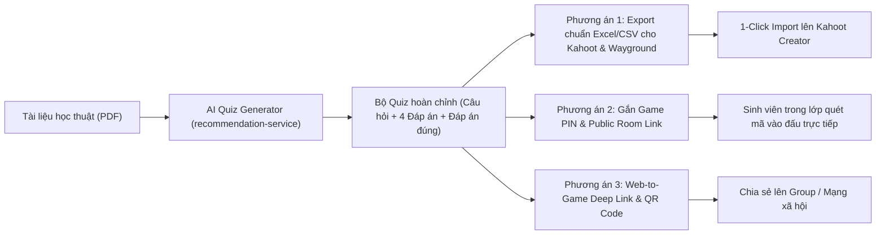
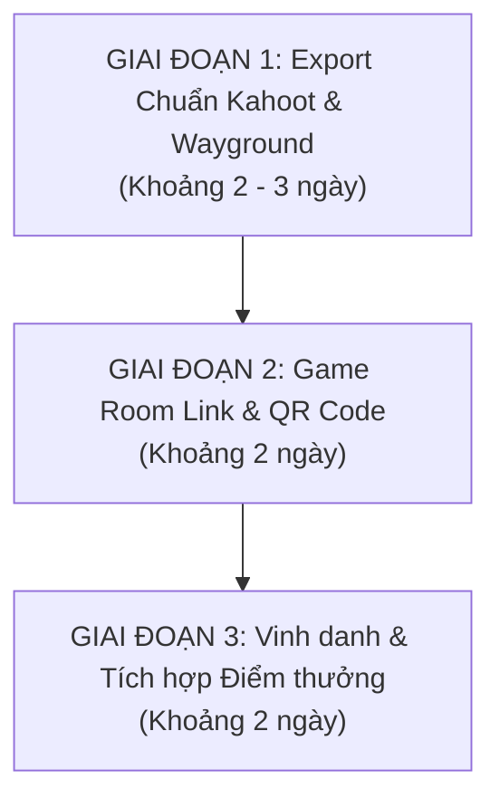

# KẾ HOẠCH TÍCH HỢP TÍNH NĂNG QUIZ LIÊN KẾT GAME HỌC TẬP (KAHOOT, WAYGROUND)

## 1. Tổng quan & Mục tiêu

### 1.1. Bối cảnh hiện tại
Hệ thống mạng học thuật hiện đã có nền tảng tạo câu hỏi trắc nghiệm tự động bằng AI (`recommendation-service`):
- AI đọc nội dung tài liệu theo chunks và sinh câu hỏi trắc nghiệm kèm 4 đáp án (A, B, C, D), giải thích và số trang tham chiếu.
- Người dùng hiện tại chỉ có thể làm bài thi trắc nghiệm nội bộ trên trang web.

### 1.2. Mục tiêu đề xuất
Mở rộng chức năng Quiz để người dùng (giảng viên, cán sự môn, nhóm học tập) có thể **đưa bộ câu hỏi vừa tạo lên các nền tảng trò chơi học tập tương tác nhiều người chơi (Gamified Learning)** như **Kahoot**, **Wayground** (hoặc Quizizz, Blooket) nhằm:
1. Tổ chức mini-game thi đua trực tiếp trong giờ học hoặc buổi học nhóm.
2. Tăng tính tương tác xã hội (Social Learning) cho mạng học thuật.
3. Đồng bộ điểm thưởng và vinh danh sinh viên tham gia giải đố.

---

## 2. Phân tích Cơ chế Liên kết Kỹ thuật

Các nền tảng như Kahoot hay Wayground hiện **không mở Public API tạo quiz trực tiếp miễn phí** cho bên thứ ba vì lý do bản quyền và mô hình kinh doanh. Do đó, giải pháp tối ưu và thực tế nhất trong ngành EdTech bao gồm 3 trụ cột sau:



### Trụ cột 1: Xuất File Mẫu Chuẩn (1-Click Template Exporter) - *Cốt lõi*
- **Kahoot**: Kahoot có tính năng chính thức cho phép giáo viên tải lên file bảng tính Excel (`.xlsx`) theo định dạng chuẩn:
  - Cột 1: `Question` (Tối đa 120 ký tự)
  - Cột 2-5: `Answer 1`, `Answer 2`, `Answer 3`, `Answer 4` (Tối đa 75 ký tự)
  - Cột 6: `Time limit (sec)` (5, 10, 20, 30, 60, 120...)
  - Cột 7: `Correct answer(s)` (Chỉ số 1, 2, 3 hoặc 4)
- **Wayground / Quizizz / Blooket**: Hỗ trợ định dạng `.xlsx` hoặc `.csv` tương tự, hoặc format văn bản câu hỏi dạng tab-separated.
- **Giải pháp**: Backend cung cấp API xuất file `.xlsx` tự động mapping đúng chuẩn của từng nền tảng. Người dùng chỉ cần tải file về và upload lên Kahoot/Wayground chỉ mất 5 giây là có ngay phòng chơi.

### Trụ cột 2: Quản lý Phòng Chơi & PIN Code (Lobby Link Integration)
- Người tạo quiz sau khi host phòng trên Kahoot/Wayground sẽ có một mã **PIN phòng** (VD: `738 1928`) hoặc **Link phòng trực tiếp**.
- Người tạo dán link/PIN này vào mục *"Tổ chức phòng chơi"* của tài liệu.
- Tất cả sinh viên đang đọc tài liệu đó sẽ thấy thông báo: *"Đang có phòng game Kahoot trực tiếp cho tài liệu này - Bấm để vào tranh tài"*.

### Trụ cột 3: Chia sẻ QR Code & Deep Link
- Tạo nhanh mã QR cho phòng chơi để hiển thị trên màn hình máy chiếu lớp học hoặc quét qua điện thoại.

---

## 3. Thiết kế Cơ sở Dữ liệu & Backend API

### 3.1. Nâng cấp Data Model (`recommendation-service`)
Cập nhật bảng `ai_quizzes` (hoặc tạo bảng phụ `quiz_game_integrations`):

```sql
ALTER TABLE ai_quizzes 
ADD COLUMN IF NOT EXISTS external_game_platform VARCHAR(50), -- 'KAHOOT', 'WAYGROUND', 'QUIZIZZ'
ADD COLUMN IF NOT EXISTS external_game_pin VARCHAR(20),      -- Mã PIN phòng (nếu có)
ADD COLUMN IF NOT EXISTS external_game_url TEXT,             -- Link trực tiếp vào phòng game
ADD COLUMN IF NOT EXISTS is_game_active BOOLEAN DEFAULT FALSE,
ADD COLUMN IF NOT EXISTS game_created_at TIMESTAMP WITH TIME ZONE;
```

### 3.2. Thiết kế Endpoints mới trên `recommendation-service`

| Method | Đường dẫn API | Chức năng | Input / Output |
| :--- | :--- | :--- | :--- |
| `GET` | `/api/v1/quizzes/{id}/export/kahoot` | Tải về file `.xlsx` định dạng chuẩn của Kahoot | Output: File Stream `kahoot_quiz_{id}.xlsx` |
| `GET` | `/api/v1/quizzes/{id}/export/wayground` | Tải về file `.xlsx` / `.csv` cho Wayground/Quizizz | Output: File Stream `wayground_quiz_{id}.xlsx` |
| `POST` | `/api/v1/quizzes/{id}/game-room` | Lưu thông tin phòng game (PIN, Link tham gia) | Body: `{ platform, gamePin, gameUrl }` |
| `GET` | `/api/v1/quizzes/{id}/game-room` | Lấy thông tin phòng game đang mở cho tài liệu | Output: Thông tin phòng + QR Code SVG |
| `DELETE`| `/api/v1/quizzes/{id}/game-room` | Đóng phòng game khi buổi chơi kết thúc | Status: 204 No Content |

---

## 4. Thiết kế Luồng Trải nghiệm Người dùng (Frontend UX/UI)

### 4.1. Màn hình chi tiết Quiz (Sau khi AI sinh câu hỏi xong)
Thêm cụm công cụ **"🎮 Trò chơi tương tác"** kế bên nút *"Làm bài kiểm tra"*:

```
[ Làm bài trắc nghiệm ]    [ 🎮 Xuất sang game ▼ ]    [ 🚀 Tổ chức phòng Kahoot ]
```

Khi bấm vào **"🎮 Xuất sang game"**, hiển thị dropdown menu:
- 🟣 **Kahoot Spreadsheet (.xlsx)**: Kèm biểu tượng Kahoot.
- 🟢 **Wayground / Quizizz (.xlsx)**: Kèm biểu tượng nền tảng.
- 📄 **Tải file văn bản (Flashcards / Anki / In đề thi)**.

### 4.2. Modal hướng dẫn 1-Click Import (Dành cho người tổ chức)
Khi người dùng bấm xuất Kahoot:
1. **Bước 1**: Tự động tải file `kahoot_template_[ten_tai_lieu].xlsx`.
2. **Bước 2**: Hiển thị popup hướng dẫn trực quan:
   - *"File đã được định dạng đúng 100% chuẩn của Kahoot (giới hạn ký tự, thời gian 30s, đánh dấu đáp án đúng)."*
   - Nút hành động: `[ Mở Kahoot Creator ]` (mở tab `create.kahoot.it` trong cửa sổ mới).
3. **Bước 3**: Nhập mã PIN phòng vừa tạo (nếu muốn mời bạn bè trên website vào chơi).

### 4.3. Widget "Phòng Đấu Trực Tiếp" (Dành cho sinh viên tham gia)
- Trên trang đọc tài liệu hoặc trang Quiz, nếu tác giả đang mở phòng chơi:
  - Xuất hiện thanh banner động: *"🔥 Đang diễn ra trận đấu Kahoot cho tài liệu này (Mã PIN: 649 201) - Còn 15 phút"*.
  - Nút `[ Vào chơi ngay ]` mở thẳng `kahoot.it?pin=649201`.

---

## 5. Lộ trình Triển khai (Roadmap)



### Giai đoạn 1: Triển khai Bộ Xuất Định Dạng (Export Engines)
- Thư viện Python: `openpyxl` hoặc `pandas`.
- Viết module `app/services/exporters/kahoot_exporter.py`:
  - Mapping: Cắt gọn câu hỏi nếu > 120 ký tự, map A/B/C/D thành cột 1, 2, 3, 4.
  - Set định dạng màu sắc header theo đúng mẫu gốc của Kahoot.
- Viết module `app/services/exporters/wayground_exporter.py` tương thích định dạng Wayground/Quizizz.
- Endpoint tải file trên FastAPI.

### Giai đoạn 2: Tích hợp Giao diện & Quản lý Phòng Chơi (Frontend & Game Lobby)
- Xây dựng component `GameExportModal` trên React/Vite.
- Thêm chức năng dán Game URL / Game PIN và tạo mã QR tự động bằng thư viện `qrcode.react`.
- Hiển thị badge phòng chơi trên danh sách tài liệu.

### Giai đoạn 3: Tính điểm Tương tác (Gamification & Social Rewards)
- Khi tác giả tạo phòng game thành công: Cộng điểm uy tín (`reputation_points`) vào tài khoản tác giả (thông qua `user-service`).
- Ghi nhận lượt tương tác `QUIZ_GAME_HOST` trong bảng `user_document_interactions`.

---

## 6. Đánh giá Rủi ro & Giải pháp Dự phòng

| Rủi ro tiềm ẩn | Mức độ | Phương án xử lý |
| :--- | :---: | :--- |
| **Độ dài câu hỏi vượt giới hạn Kahoot** (Kahoot giới hạn 120 ký tự cho câu hỏi, 75 ký tự cho đáp án) | Trung bình | Trong Prompt sinh đề của AI, thêm ràng buộc `strict_length=True` khi chọn chế độ sinh đề cho Game. Nếu vượt quá, backend tự động cắt ngắn (truncate) thông minh và giữ nguyên ý chính. |
| **Kahoot thay đổi format file Excel mẫu** | Thấp | Cấu hình cấu trúc cột qua file config/template mẫu `.xlsx` trên backend thay vì hardcode, dễ dàng điều chỉnh khi cần. |
| **Phòng chơi hết hạn nhưng vẫn hiện trên web** | Thấp | Thiết lập `TTL` (Time-to-live) mặc định cho phòng game là 2 tiếng. Sau 2 tiếng tự động ẩn banner phòng chơi. |
